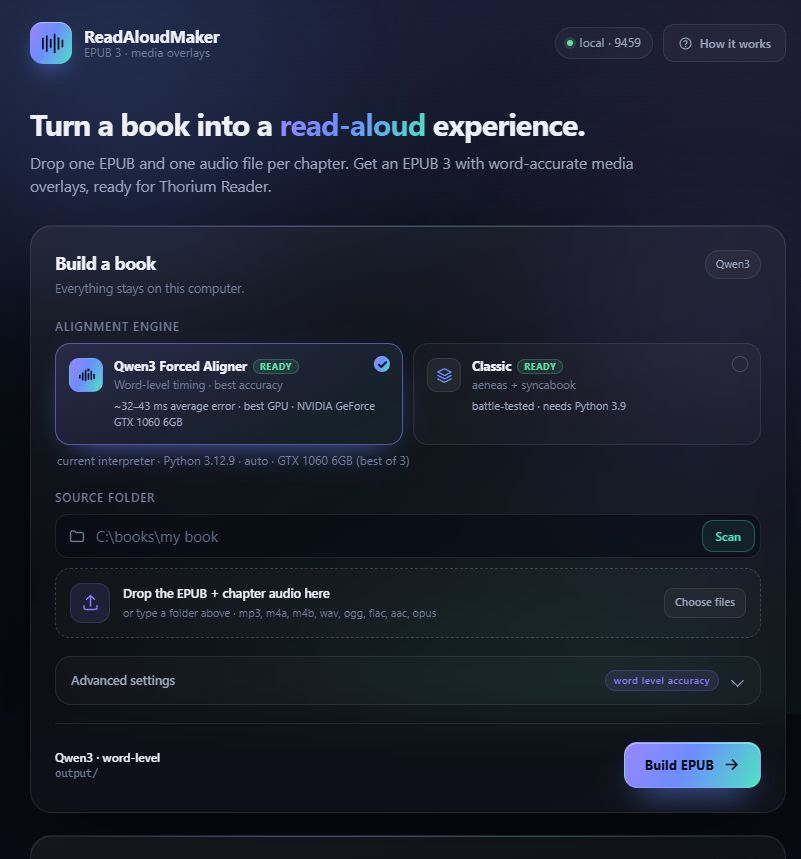

<div align="center">

<h1>ReadAloudMaker</h1>

<p><strong>Turn an EPUB and one audio file per chapter into a polished read-aloud book.</strong></p>

<p>One EPUB + chapter audio &rarr; <strong>EPUB 3 with Media Overlays</strong>, the format where
the text highlights as the narration plays. Everything runs on your computer.</p>

<p>
  <a href="https://github.com/REFLEXGAMING007/ReadAloudMaker/actions/workflows/tests.yml"></a>
  
  
  
  
</p>

<p>
  <a href="#quick-start">Quick start</a> &middot;
  <a href="#choosing-an-alignment-engine">Engines</a> &middot;
  <a href="#web-ui">Web UI</a> &middot;
  <a href="#qwen3-pipeline-v2">Qwen3 setup</a> &middot;
  <a href="#how-it-works">How it works</a> &middot;
  <a href="#troubleshooting">Troubleshooting</a>
</p>



</div>

Double-click `run.bat` (Windows) or run `./run.sh` (Linux/macOS) and the
**local web UI** opens on <http://127.0.0.1:9459>. Pick a folder, choose an
engine, press **Build EPUB**, and download `output/<book title>_readaloud.epub`.

> **One launcher, two pipelines.** `run.bat` / `run.sh` open the UI by default.
> The same command can still drive either engine from a terminal:
>
> | Command | What it does |
> |---|---|
> | `run.bat` | Web UI on `http://127.0.0.1:9459` |
> | `run.bat --v1 …` | Original **aeneas + syncabook** pipeline (CLI) |
> | `run.bat --v2 …` | **Qwen3-ForcedAligner-0.6B** pipeline (CLI) |
>
> The Qwen3 engine needs Python 3.12 + PyTorch and is documented in
> [docs/QWEN3_PIPELINE.md](docs/QWEN3_PIPELINE.md). The UI detects which
> engines are installed and only enables the ones that can actually run.

---

## Highlights

| | |
|---|---|
| **Local and private** | A small web UI served from this repository. No accounts, no cloud upload, no Docker. |
| **Two alignment engines** | Keep the battle-tested **aeneas + syncabook** pipeline, or switch to **Qwen3-ForcedAligner** for word-level timing. |
| **Picks the best GPU** | `auto` ranks every CUDA card by compute capability and free VRAM. The UI lists them all, and the build log says which one ran. |
| **Validated output** | The finished EPUB is checked before you get a success message: OPF, media overlays, every SMIL target and MP3 reference must resolve. |

---

## What it does

```
 my book.epub          chapter 1.mp3
                       chapter 2.mp3
                       chapter 3.mp3
        │                    │
        └────────┬───────────┘
                 ▼
          ReadAloudMaker
                 ▼
   output/my book_readaloud.epub
        (EPUB 3 + Media Overlays)
```

- Reads the EPUB spine, so chapters are used in the book's real order.
- Adds `id="f000001"`-style IDs to every spoken block (headings, paragraphs,
  status-box titles, scene dividers).
- Pairs audio files with chapters by **natural sort order** (`2` before `10`).
  File names do **not** need to match the EPUB's internal names — only the
  count has to match.
- Converts non-MP3 audio to MP3 automatically with FFmpeg.
- Aligns each chapter with the engine you choose: **Qwen3-ForcedAligner** for
  word-level timing, or the original [aeneas](https://www.readbeyond.it/aeneas/)
  + [syncabook](https://github.com/r4victor/syncabook) pipeline.
- Carries over the cover, title, author, language, and per-chapter titles.
- Validates the finished EPUB before telling you it worked: OPF is valid UTF-8,
  every media overlay exists, every SMIL `<par>` points at a real fragment and a
  real MP3.
- **No Docker**, no afaligner, no manual project folder. One command.

Works with any text-based EPUB whose chapter count matches the audio count.
It does not split a single full-book audiobook into chapters — see
[Limitations](#limitations).

---

## Choosing an alignment engine

Both engines produce the same EPUB 3 with Media Overlays. The classic pipeline
highlights the EPUB's spoken blocks (usually whole paragraphs), while Qwen3
splits blocks into sentences and places those sentence boundaries from
word-level timestamps. Pick one per build in the UI, or with `--v1` / `--v2` on
the command line.

**Rule of thumb:** Classic is the low-friction choice on CPU-only or older
machines; Qwen3 is worth the setup when you have a CUDA GPU and want tighter
sync.

### Classic: aeneas + syncabook

**Pros**

- **CPU-only.** No GPU, CUDA driver or PyTorch install.
- **Mature and predictable.** The original pipeline is battle-tested, and there
  is no model to download or load before the first chapter starts.
- **Modest footprint.** Python 3.9, FFmpeg and eSpeak NG, plus the packages in
  `requirements.txt`.
- **Small overlays.** Paragraph-level highlights mean fewer SMIL entries and a
  simpler timeline.

**Cons**

- **Paragraph-level highlights.** A long paragraph stays highlighted as one
  block, so the sync can visibly lag inside it.
- **DTW is an estimate.** aeneas matches the narration against an eSpeak
  rendering, so heavy accents, music, background noise or long pauses can pull
  the boundaries off.
- **Pinned to Python 3.9.** aeneas 1.7.3 ships prebuilt C extensions for 3.9;
  newer Python versions often fail to build them.
- **Needs eSpeak NG.** One more system program on `PATH` in addition to FFmpeg.
- **Rebuilds the EPUB.** Untouched fonts, images and CSS are not guaranteed to
  survive byte for byte.

### Qwen3: Qwen3-ForcedAligner-0.6B

**Pros**

- **Word-level timestamps, sentence-level highlights.** Blocks are split at
  sentence boundaries and each boundary comes from aligned words instead of a
  DTW estimate. The model card reports 32–43 ms average error depending on
  language.
- **Built for long chapters.** Windowing, a 30-second safety tail and monotonic
  clamping keep a chapter aligned without letting errors accumulate.
- **No eSpeak.** The model aligns the narration directly to the EPUB text, so
  pronunciation is less of a problem.
- **Surgical packaging.** Fonts, images, CSS and the cover are copied byte for
  byte; only chapters, the package document and the new overlays change.
- **Picks the GPU for you.** `auto` chooses the best card and falls back to CPU.

**Cons**

- **Much larger setup.** Python 3.10+ (3.12 recommended), PyTorch, qwen-asr and
  a ~1.2 GB model download on first use.
- **GPU strongly recommended.** CPU alignment is slow, and a CUDA card needs
  roughly 2.5 GB of free VRAM.
- **More moving parts.** The PyTorch wheel must match the driver, and dtype
  selection plus the 180-second alignment limit add failure modes the classic
  pipeline does not have.
- **Stricter by design.** A chapter that falls below 98% coverage is rejected
  rather than packaged with drifting timings, so a bad pairing needs a retry.
- **Newer and less battle-tested.** Fewer books have gone through this pipeline
  than through aeneas + syncabook.

---

## Requirements

| Requirement | Why |
|---|---|
| **Python 3.9** | aeneas 1.7.3 ships prebuilt C extensions for 3.9. Newer versions often fail to build them. |
| **FFmpeg + ffprobe** | audio conversion and duration probing |
| **eSpeak NG** | speech synthesis used internally by aeneas |
| **aeneas + syncabook** | installed with `pip install -r requirements.txt`. This also installs their dependencies: **lxml**, BeautifulSoup4, Jinja2, numpy and progressbar2. |

> Docker is **not** required. The original syncabook workflow used afaligner in a
> container; this tool calls aeneas directly and hands the SMIL files to
> `syncabook create`.

### Install the Python packages

```bash
python3.9 -m pip install -r requirements.txt
```

On Windows:

```bat
py -3.9 -m pip install -r requirements.txt
```

`lxml` is required, but you do not install it yourself: it is a dependency of
both aeneas and syncabook and comes in automatically with the command above.
The same applies to BeautifulSoup4, Jinja2, numpy and progressbar2.

### Install FFmpeg and eSpeak NG

**Windows**

```powershell
winget install Gyan.FFmpeg
```

eSpeak NG: download the installer from
<https://github.com/espeak-ng/espeak-ng/releases> and add its folder to `PATH`
(the installer usually does this).

**Debian / Ubuntu**

```bash
sudo apt update
sudo apt install ffmpeg espeak-ng python3.9 python3.9-venv
```

If your distribution does not provide Python 3.9, use
[deadsnakes](https://launchpad.net/~deadsnakes/+archive/ubuntu/ppa) or `pyenv`.

**macOS (Homebrew)**

```bash
brew install ffmpeg espeak-ng python@3.9
```

Check everything:

```bash
ffmpeg -version
ffprobe -version
espeak-ng --version
python3.9 -c "import aeneas; print(aeneas.__version__)"
python3.9 -c "import lxml; print(lxml.__version__)"
syncabook -h
```

---

## Quick start

1. Clone or download this repository.
2. Put your book and audio **in the repository folder**, next to `run.bat`:

   ```text
   ReadAloudMaker/
       run.bat
       run.sh
       make_readaloud.py
       requirements.txt
       ...
       my book.epub
       chapter 01.mp3
       chapter 02.mp3
       chapter 03.mp3
   ```

   - Exactly **one** `.epub`.
   - Exactly **one audio file per chapter**.
   - Supported audio: `mp3`, `m4a`, `m4b`, `wav`, `ogg`, `flac`, `aac`, `opus`.

3. Double-click `run.bat` (Windows) or run:

   ```bash
   ./run.sh
   ```

   If the executable bit was lost (common when downloading a ZIP), run
   `chmod +x run.sh` once, or use `bash run.sh`.

   Your browser opens the **ReadAloudMaker UI** on
   <http://127.0.0.1:9459>. It shows the detected engines, lets you drag the
   EPUB and audio straight onto the page, previews the chapters and audio
   pairing, and streams the build log. If the browser does not open by itself,
   visit the URL manually. Add `--no-browser` to keep the console quiet, or
   `--port 9600` to move it.

   Prefer the terminal? `run.bat --v1 --folder "C:\books\my book"` (or
   `./run.sh --v1 --folder "/books/my book"`) runs the classic pipeline
   directly, with the options listed below.

4. Open `output/<book title>_readaloud.epub` in a reader that supports Media
   Overlays. **Thorium Reader** is the easiest choice on Windows, Linux and
   macOS. Press play and the current block (or sentence with Qwen3) is
   highlighted.

> Calibre's viewer and most generic EPUB readers do **not** implement Media
> Overlays. An EPUB that looks fine there can still be a perfectly good
> read-aloud book elsewhere.

### Test without waiting for alignment

```bash
./run.sh --v1 --prepare-only
```

This unpacks the EPUB, injects IDs, copies/converts the audio, writes the
metadata and table of contents, and stops. It prints the chapter list and the
audio list, so it is the fastest way to check that the pairing is right. The
`_readaloud_work/` folder is kept so you can inspect it.

## Qwen3 pipeline (v2)

The second pipeline is independent of aeneas and syncabook. Set it up once:

```bat
py -3.12 -m venv .venv-qwen
.venv-qwen\Scripts\python.exe -m pip install torch --index-url https://download.pytorch.org/whl/cu124
.venv-qwen\Scripts\python.exe -m pip install -r requirements-qwen.txt
```

Then use it from either the UI (choose **Qwen3 Forced Aligner**) or the CLI:

```bat
run.bat --v2 --folder "C:\books\my book" --dry-run
run.bat --v2 --folder "C:\books\my book"
```

```bash
python3.12 -m venv .venv-qwen
.venv-qwen/bin/pip install torch
.venv-qwen/bin/pip install -r requirements-qwen.txt
./run.sh --v2 --folder "/books/my book" --dry-run
./run.sh --v2 --folder "/books/my book"
```

`--dry-run` needs only `lxml` and FFmpeg: it parses the EPUB, plans alignment
windows and writes `_qwen_work/plan.json` without downloading the model.
`--fake-aligner` builds a real EPUB with placeholder timings, which is useful
for checking the packager on a machine without a GPU.

`--device auto` (the UI default) picks the best CUDA card, not blindly
`cuda:0`: it ranks compute capability, then free VRAM, and skips cards with too
little memory. The UI lists every detected GPU so you can pin one. The build
log prints the exact card it chose.

See [docs/QWEN3_PIPELINE.md](docs/QWEN3_PIPELINE.md) for requirements,
options, accuracy details and GPU memory tips.

---

## Web UI

The UI is served by the same repository, uses only the Python standard library,
and never leaves this computer.

- **Engine cards** show which pipelines are ready. Detection asks each Python
  interpreter whether `aeneas`, `lxml`, `torch` and `qwen_asr` *exist*; it does
  not import torch, so the page opens in about a second.
- **Device picker** lists every detected GPU and remembers your choice. `auto`
  picks the best card instead of blindly using `cuda:0`; the build log prints
  the exact index it loaded.
- **Scan** reads the EPUB spine and lists the chapter count, sentence count and
  audio files before anything is built, and warns when the counts do not match.
- **Drag and drop** copies the EPUB and audio into a temporary folder
  (`%TEMP%\readaloud-ui-…`) and points the build at it. Nothing is written next
  to your original files.
- **Progress** is a ring plus four stages (prepare → align → package →
  validate), fed by the build's own log. MP3 decoder noise is tagged and hidden
  behind the *decoder noise* switch.
- **Cancel**, **Download EPUB** and **Open folder** all work from the result
  card.

The server binds `127.0.0.1` only and rejects requests whose `Host` or `Origin`
is not local. Two interpreters can coexist: `run.bat` prefers `.venv-qwen`
because the scan preview needs `lxml`, then falls back to `py -3.12/3.11/3.9`
and `python`. The UI itself works on Python 3.9+.

---

## Matching chapters to audio

Audio files are sorted **naturally** and paired with the EPUB spine in order:

```text
Chapter 1.mp3   ->  EPUB chapter 1
Chapter 2.mp3   ->  EPUB chapter 2
Chapter 10.mp3  ->  EPUB chapter 10   (not before chapter 2)
```

Names are only used for sorting. If the counts differ, the tool stops **before
doing any work** and prints both lists:

```text
Chapter documents found in the EPUB (spine order):
   1. EPUB/chapter0001.xhtml    Chapter 1: ...
   2. EPUB/chapter0002.xhtml    Chapter 2: ...

Audio files found (natural sort order):
   1. 01.mp3

There must be exactly one audio file per chapter.
```

Cover, nav and toc documents are skipped automatically, as are spine documents
with fewer than 50 characters of text. If your book has a title page or
copyright page with real text in the spine, either remove it from the EPUB or
exclude it with `--exclude`.

---

## Command-line options

`run.bat` / `run.sh` are dispatchers. The first argument picks the mode:

| Argument | Mode |
|---|---|
| *(none)* or `--ui` | Web UI on `http://127.0.0.1:9459` |
| `--v1` | Classic aeneas + syncabook pipeline |
| `--v2` | Qwen3-ForcedAligner pipeline (see [docs/QWEN3_PIPELINE.md](docs/QWEN3_PIPELINE.md)) |

### UI options

| Option | Meaning |
|---|---|
| `--port N` | Port to listen on (default: `9459`). |
| `--host ADDR` | Bind address (default: `127.0.0.1`, this computer only). |
| `--no-browser` | Do not open a browser window. |
| `--version` | Print the UI version. |

If the UI is already running on the port, launching it again just prints the
URL and exits instead of starting a second server.

### Classic pipeline options

These follow `--v1`:

```bat
run.bat --v1 --lang eng
run.bat --v1 --title "My Book" --author "Author Name"
```

```bash
./run.sh --v1 --lang eng
./run.sh --v1 --title "My Book" --author "Author Name"
```

| Option | Meaning |
|---|---|
| `--folder PATH` | Folder with the EPUB and audio (default: the script's folder). |
| `--epub PATH` | Use a specific EPUB (relative paths are resolved inside `--folder`). |
| `--lang CODE` | aeneas language (`eng`, `deu`, `fra`, …). Default: from the EPUB's `dc:language`, falling back to `eng`. |
| `--title TEXT` | Override the book title. |
| `--author TEXT` | Override the author. |
| `--exclude REGEX` | Skip spine documents whose path matches this regex. Default skips `cover`, `nav`, `toc`. |
| `--prepare-only` | Stop after preparation (no alignment, no EPUB). |
| `--keep-work` | Keep `_readaloud_work/` after a successful build. |
| `--version` | Print the version. |
| `-h`, `--help` | Full help. |

Language codes are passed to aeneas, so any language eSpeak NG supports works.
If the EPUB has no `dc:language`, or the narration is in another language,
**set `--lang` explicitly** — alignment quality depends on it.

---

## How it works

```text
 EPUB ──► spine order ──► inject id="f000001"… ──► sync_text/chapterNNNN.xhtml
                                                             │
 audio ──► natural sort ──► chapterNNNN.mp3 ────────────────┤
                                                             ▼
                                        aeneas (per chapter) ──► smil/chapterNNNN.smil
                                                             │
 metadata.json + nav.xhtml + colophon.xhtml + cover.jpg ─────┤
                                                             ▼
                                             syncabook create ──► EPUB 3 + Media Overlays
                                                             │
                                                             ▼
                                              built-in validation ──► output/
```

A few implementation details that matter:

- **Document order, not numeric ID order.** The ID injector numbers all
  paragraphs first, then status-box titles and scene dividers, so the IDs are
  not in reading order. aeneas is run with
  `is_text_unparsed_id_sort=unsorted`; using `numeric` would move those
  fragments to the end of the chapter and give them the wrong audio.
- **UTF-8 packaging.** `syncabook create` writes `content.opf` with the default
  system encoding. The tool runs it with `PYTHONUTF8=1`, so titles containing
  characters like `’` or `ä` stay valid UTF-8.
- **Silent fragments.** Punctuation-only fragments such as `“…”` may get a
  zero-length clip. That is harmless: they are highlighted instantly.

---

## Output

```text
output/
└── <book title>_readaloud.epub
```

Running again does not overwrite: the second file becomes
`<book title> (2)_readaloud.epub`.

On failure the `_readaloud_work/` folder is kept with:

```text
_readaloud_work/
├── audio/            converted chapterNNNN.mp3
├── sync_text/        chapterNNNN.xhtml with injected IDs
├── smil/             chapterNNNN.smil from aeneas
├── no_sync_text/     generated nav.xhtml and colophon.xhtml
├── images/           cover.jpg
├── metadata.json
└── out/              syncabook's own output
```

On success the folder is deleted (unless `--keep-work` is given).

---

## Troubleshooting

| Symptom | Fix |
|---|---|
| `no .epub file found` | Put exactly one `.epub` in the folder, or pass `--epub`. |
| `more than one .epub found` | Keep only the book you want, or pass `--epub`. |
| `There must be exactly one audio file per chapter` | Read the two printed lists. Rename, move or add the audio so the counts match. |
| `alignment failed on chapter N` | The audio for that chapter does not match its text, is silent, or the language is wrong. Check the order, then try `--lang eng`/`deu`/… |
| `aeneas is not installed for this Python` | The dispatcher could not find a Python with aeneas. Install requirements for 3.9: `py -3.9 -m pip install -r requirements.txt`, then check `run.bat --v1 --help`. |
| `missing required program(s): ffmpeg, ffprobe` | Install FFmpeg and make sure `ffmpeg -version` works in a new terminal. |
| `missing required program(s): espeak-ng` | Install eSpeak NG and add it to `PATH`. |
| `syncabook was not found` | `python3.9 -m pip install -r requirements.txt`. |
| `ModuleNotFoundError: No module named 'lxml'` | The install was interrupted or a different Python was used. Re-run `python3.9 -m pip install -r requirements.txt`; lxml comes with aeneas/syncabook. |
| The EPUB opens but there is no highlighting | Your reader does not support Media Overlays. Use Thorium Reader. |
| A few paragraphs highlight instantly | They are punctuation-only fragments (`“…”`, `[…]`). Expected. |
| Alignment is slow | Expected: aeneas synthesizes every fragment with eSpeak and then aligns audio features. A 39-minute sample took about 15–25 s on the development machine; a full-length audiobook can take several minutes. It is CPU-bound and scales roughly with the amount of audio. |
| `generated content.opf is not valid UTF-8` | You are running an old copy of `syncabook` whose default encoding is not UTF-8, or `PYTHONUTF8` was overridden. Update the tool and reinstall `requirements.txt`. |
| UI says `ReadAloudMaker UI is already running` | That is expected: the port is taken by the running instance. Open the printed URL, or start another copy with `--port 9600`. |
| UI port 9459 is used by something else | `run.bat --ui --port 9600`, or close the other program. |
| UI shows *setup* on an engine | Hover the engine card, or open **How it works** for the exact `pip` commands and missing pieces. |

### Why Python 3.9?

aeneas 1.7.3 is the last release with prebuilt extensions and it needs Python
≤ 3.9. If you must use a newer Python, install a 3.9 interpreter just for this
tool (venv, pyenv, or `py -3.9`).

---

## Limitations

- **One audio file per chapter.** A single full-book MP3 is not split
  automatically. Cut it at chapter boundaries first (for example with
  `ffmpeg -ss <start> -to <end> -i full.mp3 -c copy chapter01.mp3`).
- **Text-based EPUBs only.** No OCR, no PDF input.
- **Audio must actually match the text.** The tool aligns; it cannot invent
  narration for missing or reordered chapters.
- **Windows is the best-tested platform.** The Python pipeline is
  cross-platform and `run.sh` is provided for Linux/macOS, but those two are
  less exercised than Windows.
- **Not DRM-aware.** Encrypted EPUBs cannot be read.

---

## Development

The UI (`readaloud_ui/`) uses only the Python standard library, and
`make_readaloud.py` imports only the standard library at module load. External
tools are needed only when you actually build a book, so the unit tests run
without aeneas, FFmpeg or eSpeak installed:

```bash
python3 -m unittest discover -s tests -v
```

Tests cover ID injection, natural sorting, title sanitising, SMIL clock parsing,
EPUB reading, SMIL/text/audio reference validation, a full `--prepare-only` run
on a synthetic EPUB, the Qwen3 packager, and the UI (job commands, progress and
log parsing, cancel, HTTP routes, uploads, localhost guards).

Pull requests are welcome — see [CONTRIBUTING.md](CONTRIBUTING.md).

---

## License

[MIT](LICENSE).

This project is not affiliated with aeneas, syncabook, FFmpeg, eSpeak NG or any
reading system. Use it only with books and audio you have the right to process.

## Acknowledgements

- [aeneas](https://www.readbeyond.it/aeneas/) — forced alignment
- [syncabook](https://github.com/r4victor/syncabook) — EPUB 3 Media Overlays packaging
- [FFmpeg](https://ffmpeg.org/) — audio conversion
- [eSpeak NG](https://github.com/espeak-ng/espeak-ng) — speech synthesis used by aeneas
- [Thorium Reader](https://www.edrlab.org/software/thorium-reader/) — the reader used to verify the output
